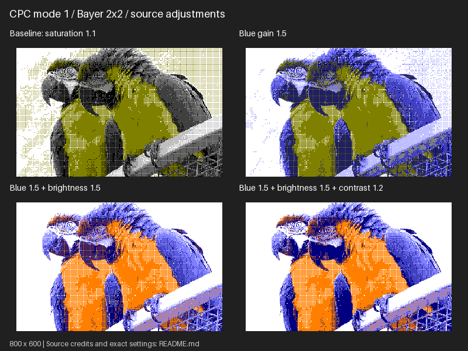

# retroimg

`retroimg` converts modern images into constrained retro-display styles.  The
project deliberately separates target geometry, palette, quantisation and
machine-specific constraints so that Teletext, Commodore 64, ZX Spectrum,
Amstrad CPC, BBC Micro, Amiga, Atari 2600 and future targets can share the same pipeline.

## Install from a checkout

From the directory containing `pyproject.toml`:

```bash
python3 -m venv .venv
source .venv/bin/activate
python3 -m pip install -e .
```

On Windows, use PowerShell:

```powershell
py -m venv .venv
.\.venv\Scripts\python.exe -m pip install -e .
.\.venv\Scripts\retroimg.exe guided
```

Without activating the Windows environment, use `.\.venv\Scripts\retroimg.exe`
in place of `retroimg` in the commands below.

Then list the built-in targets:

```bash
retroimg profiles
retroimg palettes
```

## Quick start

```bash
retroimg --version
retroimg convert /path/to/image.jpg output.png
retroimg convert /path/to/image.jpg cpc.png --profile cpc-mode0 --cpc-mode constrained --dither bayer --scale 2
retroimg convert /path/to/image.jpg spectrum.png --profile spectrum --spectrum-mode attributes --dither floyd-steinberg --scale 2
```

The default is unrestricted Teletext bitmap conversion. Every target keeps an
unrestricted mode for mixing palettes and geometry; constrained modes apply
its colour limits. Outputs are image previews, not native machine files.

## Guided CLI

Use the guided command builder to explore the options interactively:

```bash
retroimg guided /path/to/image.jpg output.png

# Prompt for file paths as well
retroimg guided

# Build and display a command without converting
retroimg guided /path/to/image.jpg output.png --print-only
```

Start fresh or load a named preset. A loaded preset opens at the summary, where
you can convert immediately or revise it. Starting fresh lets you choose a
machine and profile, then step through conversion constraints, palette,
resolution and fitting, dithering, optional colour adjustments and preview scale.
Menus accept their numbered choices or named values. Matrix sizes and screen
colour counts accept the actual values shown. Press Enter for a default, or
enter `q` at any prompt to cancel. Source colour adjustments and custom resolution
can each be skipped as a group.

Only applicable choices appear: for example, CPC modes 0/1/2 all offer Bayer,
Amiga hires excludes EHB/HAM, and constrained modes retain their palette rules.
Unrestricted modes continue to offer palette swaps. Custom dimensions are
checked against the selected cell/block layout. Suggested preview scales aim
for a convenient display size; the chosen scale is explicit in the command.

Before conversion, the guide shows a settings summary and the equivalent
`retroimg convert` command. Choose to convert, revise settings, keep the command
only, or cancel. Revisions retain previous choices as defaults and reset options
that become incompatible. Existing output files require explicit replacement;
the input image cannot be selected as the output. File paths entered at prompts
do not need shell quoting. The displayed command quotes paths for a POSIX shell
or, on Windows, PowerShell.

At input/output path prompts, press **Tab** to complete files and directories;
when several names match, Tab opens a list to choose from. Directory completion
adds a separator so you can continue into subdirectories. Relative and absolute
paths, spaces, Unicode names and `~` home paths are supported. Output paths can
end with a new filename. Enter paths literally, without surrounding quotes.
Completion uses `prompt_toolkit` on Linux, macOS and Windows (including
PowerShell). Install the optional completion extra from your checkout:

```bash
python -m pip install -e ".[guided]"
```

Or, when installing a published package, use `python -m pip install "retroimg[guided]"`.
In Windows PowerShell, the checkout command is
`.\.venv\Scripts\python.exe -m pip install -e ".[guided]"`.
Without this extra, the guide still works with ordinary path input. Redirected
or piped input also uses ordinary text entry. The base installation requires
only Pillow.

The guide only builds arguments and delegates to the existing `convert` command.
Normal CLI usage and image conversion are unchanged.

## Presets

The guide offers a list of built-in and user presets, showing each name and
description. At the final review, choose **Save as a new preset** to name your
settings. A loaded user preset also offers **Update loaded preset**, with an
explicit confirmation. Built-in presets can be saved as user copies.

Presets store conversion settings separately from input/output paths. List or
apply them directly:

```bash
retroimg presets

# Built-in macaws example: CPC mode 1, Bayer 2x2, saturation 1.1, blue gain 1.5
retroimg guided /path/to/image.jpg output.png --preset builtin:cpc-macaws-bayer2
retroimg convert /path/to/image.jpg output.png --preset builtin:cpc-macaws-bayer2

# Explicit flags override saved settings, including neutral values
retroimg convert /path/to/image.jpg output.png \
    --preset builtin:cpc-macaws-bayer2 --blue-gain 1.0

# Load a shared JSON file
retroimg convert /path/to/image.jpg output.png --preset /path/to/my-style.json
```

The other built-in examples are `builtin:c64-landscape-green` and
`builtin:teletext-mosaic-bayer4`. Colour adjustments are source-dependent;
these examples provide starting points for experimentation.

User presets live in `$XDG_CONFIG_HOME/retroimg/presets` or
`~/.config/retroimg/presets` on Linux, and `%APPDATA%\retroimg\presets` on Windows.
Use `--presets-dir /path/to/presets` with `guided`, `convert` or `presets` to
choose another directory. Listing and loading do not create it; saving does.
The versioned JSON format, naming and override rules are described in
[preset documentation](docs/presets.md).

## Targets and conversion options

| Target | Constrained modes | Reference |
| --- | --- | --- |
| Teletext | Two colours per 2×3 mosaic cell | [Teletext](docs/targets/teletext.md) |
| ZX Spectrum | Ink/paper and shared BRIGHT per 8×8 cell | [Spectrum](docs/targets/spectrum.md) |
| Commodore 64 | Multicolour cells with a shared background | [C64](docs/targets/c64.md) |
| Amstrad CPC | Modes 0/1/2 with 16/4/2 screen colours | [CPC](docs/targets/cpc.md) |
| BBC Micro | Modes 0/1/2/4/5 with steady colours | [BBC Micro](docs/targets/bbc.md) |
| Amiga OCS/ECS | Indexed 2–32 colours, EHB and HAM6 | [Amiga](docs/targets/amiga.md) |
| Atari 2600 | Independent, repeated or mirrored playfields | [Atari 2600](docs/targets/atari2600.md) |

All targets offer no dithering, Floyd–Steinberg and Bayer (2×2, 4×4 or 8×8).
Source controls include brightness, contrast, saturation, hue shift and
red/green/blue gains. For example, add `--brightness 1.1 --contrast 1.2` for a
10% brightness boost and stronger contrast. Both default to `1.0` (neutral),
and the guide includes them under **Adjust source colours**.
Resolution, fitting, palettes and preview scaling are configurable. See
[conversion options and comparison commands](docs/conversion.md) for details.
CRT/scanline effects and native hardware export are deferred.

## Example results

The [sample comparisons](samples/comparisons/README.md) show selected conversions
of the bundled public-domain/CC0 reference photographs. Eight **800×600** panels
cover all target families and a macaws adjustment recipe. Each has readable
labels, source credits and expandable reproduction commands.



Refresh the documentation panels in `samples/comparisons`:

```bash
python examples/generate_samples.py --replace
```

Individual conversions are temporary; only the eight panels and their records
are retained. Large galleries remain optional, for deliberate visual testing:

```bash
python examples/generate_gallery.py --public-only --dither-comparison --output-dir /path/to/new-gallery
```

Large galleries and experiments belong outside the repository. See
[reference images and rights](samples/README.md) and the
[gallery runner documentation](examples/README.md).

## Development

[CONTRIBUTING.md](CONTRIBUTING.md) describes development installation, tests,
package checks and CI. The [architecture notes](docs/architecture.md) and
[logical representations](docs/representations.md) explain module boundaries
and future direction. Recent changes are recorded in [CHANGELOG.md](CHANGELOG.md).

## Licence

The software is distributed under the [MIT licence](LICENSE). Bundled photographs
retain their individual public-domain/CC0 source records; see
[samples/README.md](samples/README.md). Software licensing does not replace
those image records.
