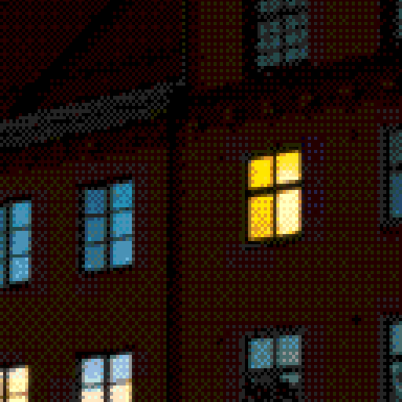
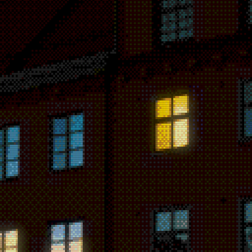

# Bloom and combined CRT examples

The same 320×224 Mega Drive tile conversion, rendered at scale 4 with
4:3 aspect correction (1280×960). One scanline beam per logical row:
224 beams across the full image height, with smooth fractional spacing.
The night photograph has bright window lights against dark brickwork,
with a detail crop around an isolated lit window to make the halo easier to judge.
Bloom adds a soft highlight glow without blurring the original pixels.
Compare bloom alone, CRT alone, then CRT with subtle and stronger bloom.
All CRT versions use the same grille/scanline strength 0.35;
the regular comparisons use radius 1 logical pixel width (4 output pixels).
The final wider-glow example keeps strong bloom 0.85 and uses radius 3
(12 output pixels), explicitly demonstrating the spread control.
Display brightness stays neutral at 1 throughout.
Each detail crop is an unscaled 512×512 section of its full-size PNG.
Open the PNGs at 100% to judge the display pattern; browser fitting can introduce moiré.

Source: [city-night.jpg](../sources/city-night.jpg).
Credit: Martin Eklund (Teadrinker), 27 October 2012. CC0 1.0 Universal Public Domain Dedication.
See [source records](../README.md) and [effect documentation](../../docs/display-effects.md).

Order: display treatment, highlight bloom, final display brightness.
This is a static aesthetic approximation. Conversion codes are identical.

## Plain conversion

[Open full-size example](megadrive-plain.png) · [Open detail crop](megadrive-plain-crop.png)


```bash
retroimg convert /path/to/image.jpg megadrive-plain.png --profile megadrive-320 --megadrive-mode tiles --scale 4 --fit cover --dither bayer --bayer-size 4
```

## Bloom alone / bloom strength 0.25 / radius 1.0

[Open full-size example](megadrive-bloom-only.png) · [Open detail crop](megadrive-bloom-only-crop.png)



```bash
retroimg convert /path/to/image.jpg megadrive-bloom-only.png --profile megadrive-320 --megadrive-mode tiles --scale 4 --fit cover --dither bayer --bayer-size 4 --bloom-strength 0.25 --bloom-radius 1.0
```

## CRT alone / strength 0.35

[Open full-size example](megadrive-crt-only.png) · [Open detail crop](megadrive-crt-only-crop.png)


```bash
retroimg convert /path/to/image.jpg megadrive-crt-only.png --profile megadrive-320 --megadrive-mode tiles --scale 4 --fit cover --dither bayer --bayer-size 4 --display-effect crt-aperture --effect-strength 0.35
```

## CRT + bloom / bloom strength 0.25 / radius 1.0

[Open full-size example](megadrive-crt-bloom-subtle.png) · [Open detail crop](megadrive-crt-bloom-subtle-crop.png)


```bash
retroimg convert /path/to/image.jpg megadrive-crt-bloom-subtle.png --profile megadrive-320 --megadrive-mode tiles --scale 4 --fit cover --dither bayer --bayer-size 4 --display-effect crt-aperture --effect-strength 0.35 --bloom-strength 0.25 --bloom-radius 1.0
```

## CRT + bloom / bloom strength 0.85 / radius 1.0

[Open full-size example](megadrive-crt-bloom-strong.png) · [Open detail crop](megadrive-crt-bloom-strong-crop.png)


```bash
retroimg convert /path/to/image.jpg megadrive-crt-bloom-strong.png --profile megadrive-320 --megadrive-mode tiles --scale 4 --fit cover --dither bayer --bayer-size 4 --display-effect crt-aperture --effect-strength 0.35 --bloom-strength 0.85 --bloom-radius 1.0
```

## CRT + bloom / bloom strength 0.85 / radius 3.0

[Open full-size example](megadrive-crt-bloom-wide.png) · [Open detail crop](megadrive-crt-bloom-wide-crop.png)



```bash
retroimg convert /path/to/image.jpg megadrive-crt-bloom-wide.png --profile megadrive-320 --megadrive-mode tiles --scale 4 --fit cover --dither bayer --bayer-size 4 --display-effect crt-aperture --effect-strength 0.35 --bloom-strength 0.85 --bloom-radius 3.0
```

Refresh from the project root:

```bash
python examples/generate_display_effects.py --effect bloom --replace
```
