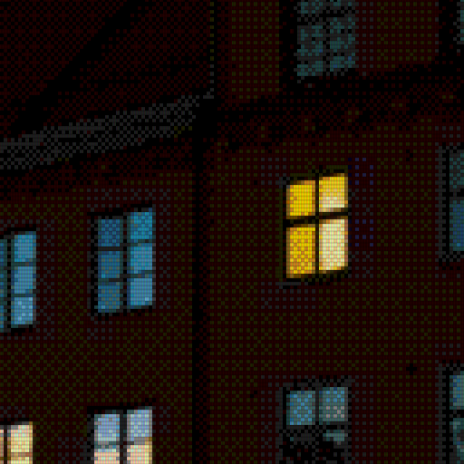
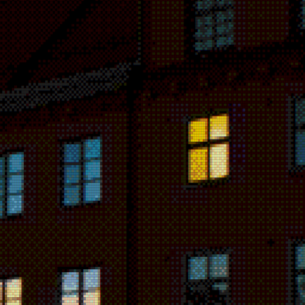
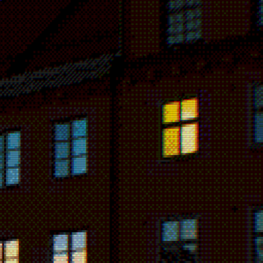

# Chromatic aberration and combined effects

The same 320×224 Mega Drive tile conversion, rendered at scale 4 with
4:3 aspect correction (1280×960). One scanline beam per logical row:
224 beams across the full image height, with smooth fractional spacing.
Bright windows near the frame edge show radial red/blue colour separation.
Red expands outwards, blue contracts inwards, and green stays fixed.
The crop retains the full frame centre and displacement; it is not reprocessed.
Compare plain, subtle/strong chromatic aberration alone, then CRT + bloom
without and with the same chromatic settings. CRT strength remains 0.35,
bloom strength 0.25, bloom radius 1, and display brightness 1 throughout.
Order: chromatic aberration, display treatment, bloom, final display brightness.
Each detail crop is an unscaled 512×512 section of its full-size PNG.
Open the PNGs at 100% to judge the display pattern; browser fitting can introduce moiré.

Source: [city-night.jpg](../sources/city-night.jpg).
Credit: Martin Eklund (Teadrinker), 27 October 2012. CC0 1.0 Universal Public Domain Dedication.
See [source records](../README.md) and [effect documentation](../../docs/display-effects.md).

The original indexed conversion stays unchanged by all effects.
This is a static aesthetic approximation. Conversion codes are identical.

## Plain conversion

[Open full-size example](megadrive-plain.png) · [Open detail crop](megadrive-plain-crop.png)


```bash
retroimg convert /path/to/image.jpg megadrive-plain.png --profile megadrive-320 --megadrive-mode tiles --scale 4 --fit cover --dither bayer --bayer-size 4
```

## Chromatic aberration alone / chromatic strength 0.25

[Open full-size example](megadrive-chromatic-subtle.png) · [Open detail crop](megadrive-chromatic-subtle-crop.png)


```bash
retroimg convert /path/to/image.jpg megadrive-chromatic-subtle.png --profile megadrive-320 --megadrive-mode tiles --scale 4 --fit cover --dither bayer --bayer-size 4 --chromatic-strength 0.25
```

## Chromatic aberration alone / chromatic strength 0.85

[Open full-size example](megadrive-chromatic-strong.png) · [Open detail crop](megadrive-chromatic-strong-crop.png)


```bash
retroimg convert /path/to/image.jpg megadrive-chromatic-strong.png --profile megadrive-320 --megadrive-mode tiles --scale 4 --fit cover --dither bayer --bayer-size 4 --chromatic-strength 0.85
```

## CRT + bloom, without chromatic aberration

[Open full-size example](megadrive-crt-bloom.png) · [Open detail crop](megadrive-crt-bloom-crop.png)



```bash
retroimg convert /path/to/image.jpg megadrive-crt-bloom.png --profile megadrive-320 --megadrive-mode tiles --scale 4 --fit cover --dither bayer --bayer-size 4 --display-effect crt-aperture --effect-strength 0.35 --bloom-strength 0.25 --bloom-radius 1.0
```

## CRT + bloom + chromatic aberration / chromatic strength 0.25

[Open full-size example](megadrive-crt-bloom-chromatic-subtle.png) · [Open detail crop](megadrive-crt-bloom-chromatic-subtle-crop.png)



```bash
retroimg convert /path/to/image.jpg megadrive-crt-bloom-chromatic-subtle.png --profile megadrive-320 --megadrive-mode tiles --scale 4 --fit cover --dither bayer --bayer-size 4 --display-effect crt-aperture --effect-strength 0.35 --bloom-strength 0.25 --bloom-radius 1.0 --chromatic-strength 0.25
```

## CRT + bloom + chromatic aberration / chromatic strength 0.85

[Open full-size example](megadrive-crt-bloom-chromatic-strong.png) · [Open detail crop](megadrive-crt-bloom-chromatic-strong-crop.png)



```bash
retroimg convert /path/to/image.jpg megadrive-crt-bloom-chromatic-strong.png --profile megadrive-320 --megadrive-mode tiles --scale 4 --fit cover --dither bayer --bayer-size 4 --display-effect crt-aperture --effect-strength 0.35 --bloom-strength 0.25 --bloom-radius 1.0 --chromatic-strength 0.85
```

Refresh from the project root:

```bash
python examples/generate_display_effects.py --effect chromatic-aberration --replace
```
