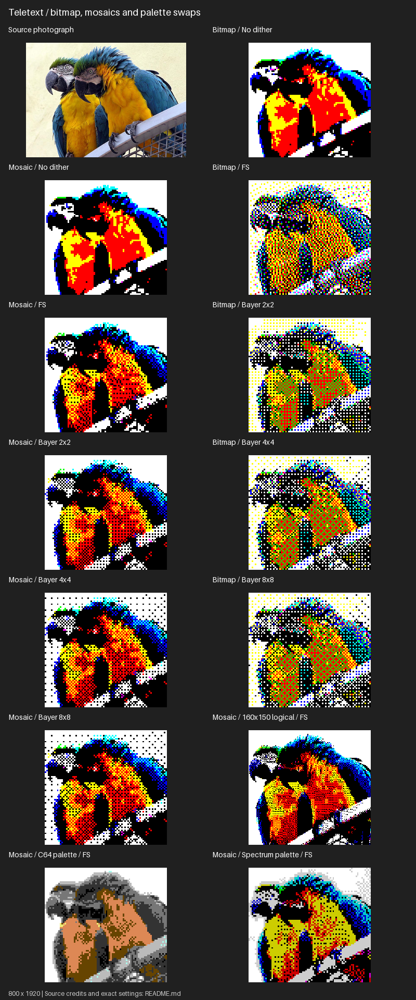
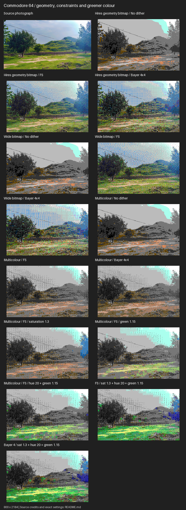
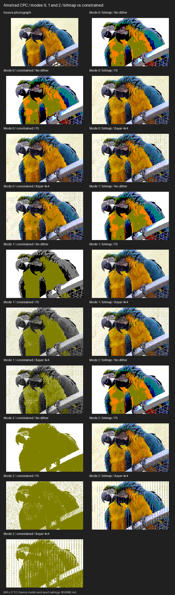
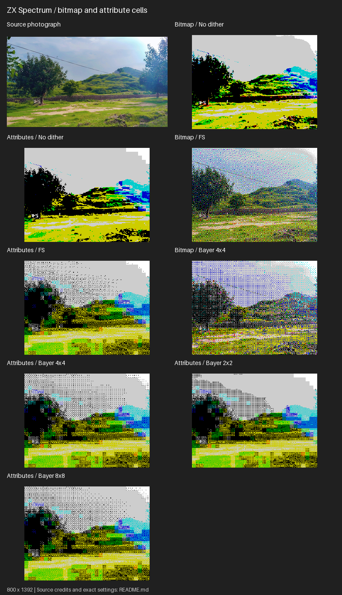
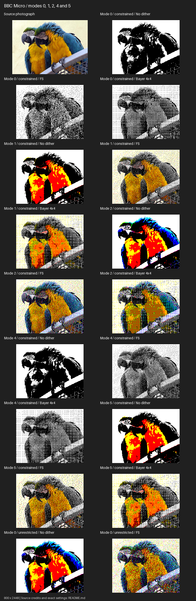
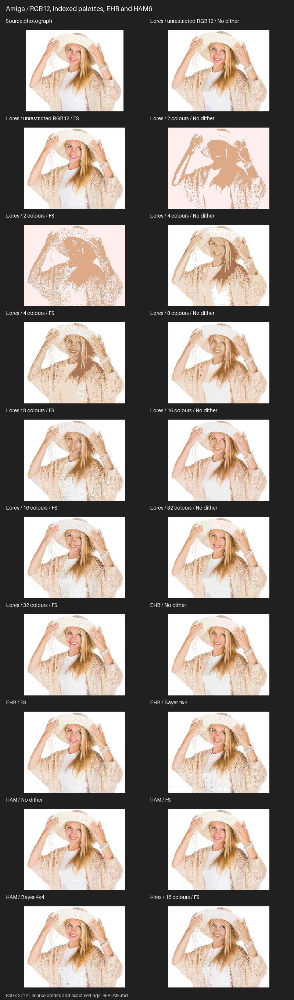
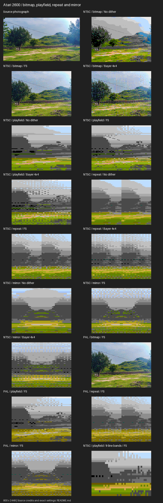

# Sample mode comparisons

Eight lossless PNG panels, **800 pixels wide**, arranged in two columns.
Panels grow vertically to show more modes, with at most ten rows each.
FS means Floyd–Steinberg. No dither, FS and Bayer are compared throughout.
CPC covers modes 0/1/2; BBC covers 0/1/2/4/5; Amiga includes indexed/EHB/HAM.
C64 includes neutral and greener saturation/hue/channel-gain examples.
Teletext uses the colourful macaws for bitmap and mosaic comparisons.

Converted previews are fitted with nearest-neighbour resizing for documentation.
They are thumbnails; inspect regenerated individual PNGs for exact pixel patterns.
Source thumbnails use smooth resizing. Palette counts in the manifest refer to
the original conversions, not labels, source photos or whole panels.

Source credits and rights: [reference images](../README.md).

Refresh these panels from the project root:

```bash
python examples/generate_samples.py --replace
```

This defaults to `samples/comparisons`. Use `--output-dir /path/to/new-samples`
for a separate set. Only known sample files are replaced; other files are refused.
Individual conversions are temporary and cleaned up automatically.

The manifest records source/panel checksums, settings, PNG checksums and colour counts.
Commands use `/path/to/image.jpg`; substitute the indicated source and choose an output
directory. Commands are single-line POSIX syntax; the shown options also work in PowerShell.

## Teletext / bitmap, mosaics and palette swaps

Source: [macaws.jpg](../sources/macaws.jpg). Credit: Adrian Pingstone (Arpingstone), July 2004. Released into the public domain by the photographer, with an unrestricted-use fallback.



<details>
<summary>Settings and reproduction commands</summary>

### Bitmap / No dither

```bash
retroimg convert /path/to/image.jpg macaws-teletext-bitmap-none.png --profile teletext --teletext-mode bitmap --dither none --scale 6 --fit cover
```

### Mosaic / No dither

```bash
retroimg convert /path/to/image.jpg macaws-teletext-mosaic-none.png --profile teletext --teletext-mode mosaic --dither none --scale 6 --fit cover
```

### Bitmap / FS

```bash
retroimg convert /path/to/image.jpg macaws-teletext-bitmap-floyd-steinberg.png --profile teletext --teletext-mode bitmap --dither floyd-steinberg --scale 6 --fit cover
```

### Mosaic / FS

```bash
retroimg convert /path/to/image.jpg macaws-teletext-mosaic-floyd-steinberg.png --profile teletext --teletext-mode mosaic --dither floyd-steinberg --scale 6 --fit cover
```

### Bitmap / Bayer 2x2

```bash
retroimg convert /path/to/image.jpg macaws-teletext-bitmap-bayer-bayer_size-2.png --profile teletext --teletext-mode bitmap --dither bayer --scale 6 --bayer-size 2 --fit cover
```

### Mosaic / Bayer 2x2

```bash
retroimg convert /path/to/image.jpg macaws-teletext-mosaic-bayer-bayer_size-2.png --profile teletext --teletext-mode mosaic --dither bayer --scale 6 --bayer-size 2 --fit cover
```

### Bitmap / Bayer 4x4

```bash
retroimg convert /path/to/image.jpg macaws-teletext-bitmap-bayer-bayer_size-4.png --profile teletext --teletext-mode bitmap --dither bayer --scale 6 --bayer-size 4 --fit cover
```

### Mosaic / Bayer 4x4

```bash
retroimg convert /path/to/image.jpg macaws-teletext-mosaic-bayer-bayer_size-4.png --profile teletext --teletext-mode mosaic --dither bayer --scale 6 --bayer-size 4 --fit cover
```

### Bitmap / Bayer 8x8

```bash
retroimg convert /path/to/image.jpg macaws-teletext-bitmap-bayer-bayer_size-8.png --profile teletext --teletext-mode bitmap --dither bayer --scale 6 --bayer-size 8 --fit cover
```

### Mosaic / Bayer 8x8

```bash
retroimg convert /path/to/image.jpg macaws-teletext-mosaic-bayer-bayer_size-8.png --profile teletext --teletext-mode mosaic --dither bayer --scale 6 --bayer-size 8 --fit cover
```

### Mosaic / 160x150 logical / FS

```bash
retroimg convert /path/to/image.jpg macaws-teletext-mosaic-large-floyd-steinberg.png --profile teletext --teletext-mode mosaic --width 160 --height 150 --scale 3 --dither floyd-steinberg --fit cover
```

### Mosaic / C64 palette / FS

```bash
retroimg convert /path/to/image.jpg macaws-teletext-mosaic-c64-floyd-steinberg.png --profile teletext --teletext-mode mosaic --palette c64 --scale 6 --dither floyd-steinberg --fit cover
```

### Mosaic / Spectrum palette / FS

```bash
retroimg convert /path/to/image.jpg macaws-teletext-mosaic-spectrum-floyd-steinberg.png --profile teletext --teletext-mode mosaic --palette spectrum --scale 6 --dither floyd-steinberg --fit cover
```

</details>

## Commodore 64 / geometry, constraints and greener colour

Source: [lush-landscape.jpg](../sources/lush-landscape.jpg). Credit: Baap8969. CC0 1.0 Universal Public Domain Dedication



<details>
<summary>Settings and reproduction commands</summary>

### Hires geometry bitmap / No dither

```bash
retroimg convert /path/to/image.jpg lush-landscape-c64-bitmap-none-profile_name-c64-hires.png --profile c64-hires --c64-mode bitmap --dither none --scale 2 --fit cover
```

### Hires geometry bitmap / FS

```bash
retroimg convert /path/to/image.jpg lush-landscape-c64-bitmap-floyd-steinberg-profile_name-c64-hires.png --profile c64-hires --c64-mode bitmap --dither floyd-steinberg --scale 2 --fit cover
```

### Hires geometry bitmap / Bayer 4x4

```bash
retroimg convert /path/to/image.jpg lush-landscape-c64-bitmap-bayer-profile_name-c64-hires.png --profile c64-hires --c64-mode bitmap --dither bayer --scale 2 --bayer-size 4 --fit cover
```

### Wide bitmap / No dither

```bash
retroimg convert /path/to/image.jpg lush-landscape-c64-bitmap-none.png --profile c64-multicolour --c64-mode bitmap --dither none --scale 2 --fit cover
```

### Wide bitmap / FS

```bash
retroimg convert /path/to/image.jpg lush-landscape-c64-bitmap-floyd-steinberg.png --profile c64-multicolour --c64-mode bitmap --dither floyd-steinberg --scale 2 --fit cover
```

### Wide bitmap / Bayer 4x4

```bash
retroimg convert /path/to/image.jpg lush-landscape-c64-bitmap-bayer.png --profile c64-multicolour --c64-mode bitmap --dither bayer --scale 2 --bayer-size 4 --fit cover
```

### Multicolour / No dither

```bash
retroimg convert /path/to/image.jpg lush-landscape-c64-multicolour-none.png --profile c64-multicolour --c64-mode multicolour --dither none --scale 2 --fit cover
```

### Multicolour / FS

```bash
retroimg convert /path/to/image.jpg lush-landscape-c64-multicolour-floyd-steinberg.png --profile c64-multicolour --c64-mode multicolour --dither floyd-steinberg --scale 2 --fit cover
```

### Multicolour / Bayer 4x4

```bash
retroimg convert /path/to/image.jpg lush-landscape-c64-multicolour-bayer.png --profile c64-multicolour --c64-mode multicolour --dither bayer --scale 2 --bayer-size 4 --fit cover
```

### Multicolour / FS / saturation 1.3

```bash
retroimg convert /path/to/image.jpg lush-landscape-c64-multicolour-floyd-steinberg-saturation-1.3.png --profile c64-multicolour --c64-mode multicolour --dither floyd-steinberg --scale 2 --saturation 1.3 --fit cover
```

### Multicolour / FS / green 1.15

```bash
retroimg convert /path/to/image.jpg lush-landscape-c64-multicolour-floyd-steinberg-green_gain-1.15.png --profile c64-multicolour --c64-mode multicolour --dither floyd-steinberg --scale 2 --green-gain 1.15 --fit cover
```

### Multicolour / FS / hue 20 + green 1.15

```bash
retroimg convert /path/to/image.jpg lush-landscape-c64-multicolour-floyd-steinberg-hue_shift-20-green_gain-1.15.png --profile c64-multicolour --c64-mode multicolour --dither floyd-steinberg --scale 2 --hue-shift 20 --green-gain 1.15 --fit cover
```

### FS / sat 1.3 + hue 20 + green 1.15

```bash
retroimg convert /path/to/image.jpg lush-landscape-c64-multicolour-floyd-steinberg-saturation-1.3-hue_shift-20-green_gain-1.15.png --profile c64-multicolour --c64-mode multicolour --dither floyd-steinberg --scale 2 --saturation 1.3 --hue-shift 20 --green-gain 1.15 --fit cover
```

### Bayer 4 / sat 1.3 + hue 20 + green 1.15

```bash
retroimg convert /path/to/image.jpg lush-landscape-c64-multicolour-bayer-saturation-1.3-hue_shift-20-green_gain-1.15.png --profile c64-multicolour --c64-mode multicolour --dither bayer --scale 2 --saturation 1.3 --hue-shift 20 --green-gain 1.15 --bayer-size 4 --fit cover
```

</details>

## Amstrad CPC / modes 0, 1 and 2 / bitmap vs constrained

Source: [macaws.jpg](../sources/macaws.jpg). Credit: Adrian Pingstone (Arpingstone), July 2004. Released into the public domain by the photographer, with an unrestricted-use fallback.



<details>
<summary>Settings and reproduction commands</summary>

### Mode 0 / bitmap / No dither

```bash
retroimg convert /path/to/image.jpg macaws-cpc-mode0-bitmap-none.png --profile cpc-mode0 --cpc-mode bitmap --dither none --scale 2 --fit cover
```

### Mode 0 / constrained / No dither

```bash
retroimg convert /path/to/image.jpg macaws-cpc-mode0-constrained-none.png --profile cpc-mode0 --cpc-mode constrained --dither none --scale 2 --fit cover
```

### Mode 0 / bitmap / FS

```bash
retroimg convert /path/to/image.jpg macaws-cpc-mode0-bitmap-floyd-steinberg.png --profile cpc-mode0 --cpc-mode bitmap --dither floyd-steinberg --scale 2 --fit cover
```

### Mode 0 / constrained / FS

```bash
retroimg convert /path/to/image.jpg macaws-cpc-mode0-constrained-floyd-steinberg.png --profile cpc-mode0 --cpc-mode constrained --dither floyd-steinberg --scale 2 --fit cover
```

### Mode 0 / bitmap / Bayer 4x4

```bash
retroimg convert /path/to/image.jpg macaws-cpc-mode0-bitmap-bayer.png --profile cpc-mode0 --cpc-mode bitmap --dither bayer --scale 2 --bayer-size 4 --fit cover
```

### Mode 0 / constrained / Bayer 4x4

```bash
retroimg convert /path/to/image.jpg macaws-cpc-mode0-constrained-bayer.png --profile cpc-mode0 --cpc-mode constrained --dither bayer --scale 2 --bayer-size 4 --fit cover
```

### Mode 1 / bitmap / No dither

```bash
retroimg convert /path/to/image.jpg macaws-cpc-mode1-bitmap-none.png --profile cpc-mode1 --cpc-mode bitmap --dither none --scale 2 --fit cover
```

### Mode 1 / constrained / No dither

```bash
retroimg convert /path/to/image.jpg macaws-cpc-mode1-constrained-none.png --profile cpc-mode1 --cpc-mode constrained --dither none --scale 2 --fit cover
```

### Mode 1 / bitmap / FS

```bash
retroimg convert /path/to/image.jpg macaws-cpc-mode1-bitmap-floyd-steinberg.png --profile cpc-mode1 --cpc-mode bitmap --dither floyd-steinberg --scale 2 --fit cover
```

### Mode 1 / constrained / FS

```bash
retroimg convert /path/to/image.jpg macaws-cpc-mode1-constrained-floyd-steinberg.png --profile cpc-mode1 --cpc-mode constrained --dither floyd-steinberg --scale 2 --fit cover
```

### Mode 1 / bitmap / Bayer 4x4

```bash
retroimg convert /path/to/image.jpg macaws-cpc-mode1-bitmap-bayer.png --profile cpc-mode1 --cpc-mode bitmap --dither bayer --scale 2 --bayer-size 4 --fit cover
```

### Mode 1 / constrained / Bayer 4x4

```bash
retroimg convert /path/to/image.jpg macaws-cpc-mode1-constrained-bayer.png --profile cpc-mode1 --cpc-mode constrained --dither bayer --scale 2 --bayer-size 4 --fit cover
```

### Mode 2 / bitmap / No dither

```bash
retroimg convert /path/to/image.jpg macaws-cpc-mode2-bitmap-none.png --profile cpc-mode2 --cpc-mode bitmap --dither none --scale 1 --fit cover
```

### Mode 2 / constrained / No dither

```bash
retroimg convert /path/to/image.jpg macaws-cpc-mode2-constrained-none.png --profile cpc-mode2 --cpc-mode constrained --dither none --scale 1 --fit cover
```

### Mode 2 / bitmap / FS

```bash
retroimg convert /path/to/image.jpg macaws-cpc-mode2-bitmap-floyd-steinberg.png --profile cpc-mode2 --cpc-mode bitmap --dither floyd-steinberg --scale 1 --fit cover
```

### Mode 2 / constrained / FS

```bash
retroimg convert /path/to/image.jpg macaws-cpc-mode2-constrained-floyd-steinberg.png --profile cpc-mode2 --cpc-mode constrained --dither floyd-steinberg --scale 1 --fit cover
```

### Mode 2 / bitmap / Bayer 4x4

```bash
retroimg convert /path/to/image.jpg macaws-cpc-mode2-bitmap-bayer.png --profile cpc-mode2 --cpc-mode bitmap --dither bayer --scale 1 --bayer-size 4 --fit cover
```

### Mode 2 / constrained / Bayer 4x4

```bash
retroimg convert /path/to/image.jpg macaws-cpc-mode2-constrained-bayer.png --profile cpc-mode2 --cpc-mode constrained --dither bayer --scale 1 --bayer-size 4 --fit cover
```

</details>

## ZX Spectrum / bitmap and attribute cells

Source: [lush-landscape.jpg](../sources/lush-landscape.jpg). Credit: Baap8969. CC0 1.0 Universal Public Domain Dedication



<details>
<summary>Settings and reproduction commands</summary>

### Bitmap / No dither

```bash
retroimg convert /path/to/image.jpg lush-landscape-spectrum-bitmap-none.png --profile spectrum --spectrum-mode bitmap --dither none --scale 2 --fit cover
```

### Attributes / No dither

```bash
retroimg convert /path/to/image.jpg lush-landscape-spectrum-attributes-none.png --profile spectrum --spectrum-mode attributes --dither none --scale 2 --fit cover
```

### Bitmap / FS

```bash
retroimg convert /path/to/image.jpg lush-landscape-spectrum-bitmap-floyd-steinberg.png --profile spectrum --spectrum-mode bitmap --dither floyd-steinberg --scale 2 --fit cover
```

### Attributes / FS

```bash
retroimg convert /path/to/image.jpg lush-landscape-spectrum-attributes-floyd-steinberg.png --profile spectrum --spectrum-mode attributes --dither floyd-steinberg --scale 2 --fit cover
```

### Bitmap / Bayer 4x4

```bash
retroimg convert /path/to/image.jpg lush-landscape-spectrum-bitmap-bayer.png --profile spectrum --spectrum-mode bitmap --dither bayer --scale 2 --bayer-size 4 --fit cover
```

### Attributes / Bayer 4x4

```bash
retroimg convert /path/to/image.jpg lush-landscape-spectrum-attributes-bayer.png --profile spectrum --spectrum-mode attributes --dither bayer --scale 2 --bayer-size 4 --fit cover
```

### Attributes / Bayer 2x2

```bash
retroimg convert /path/to/image.jpg lush-landscape-spectrum-attributes-bayer-bayer_size-2.png --profile spectrum --spectrum-mode attributes --dither bayer --scale 2 --bayer-size 2 --fit cover
```

### Attributes / Bayer 8x8

```bash
retroimg convert /path/to/image.jpg lush-landscape-spectrum-attributes-bayer-bayer_size-8.png --profile spectrum --spectrum-mode attributes --dither bayer --scale 2 --bayer-size 8 --fit cover
```

</details>

## BBC Micro / modes 0, 1, 2, 4 and 5

Source: [macaws.jpg](../sources/macaws.jpg). Credit: Adrian Pingstone (Arpingstone), July 2004. Released into the public domain by the photographer, with an unrestricted-use fallback.



<details>
<summary>Settings and reproduction commands</summary>

### Mode 0 / constrained / No dither

```bash
retroimg convert /path/to/image.jpg macaws-bbc-mode0-constrained-none.png --profile bbc-mode0 --bbc-mode constrained --dither none --scale 1 --fit cover
```

### Mode 0 / constrained / FS

```bash
retroimg convert /path/to/image.jpg macaws-bbc-mode0-constrained-floyd-steinberg.png --profile bbc-mode0 --bbc-mode constrained --dither floyd-steinberg --scale 1 --fit cover
```

### Mode 0 / constrained / Bayer 4x4

```bash
retroimg convert /path/to/image.jpg macaws-bbc-mode0-constrained-bayer.png --profile bbc-mode0 --bbc-mode constrained --dither bayer --scale 1 --bayer-size 4 --fit cover
```

### Mode 1 / constrained / No dither

```bash
retroimg convert /path/to/image.jpg macaws-bbc-mode1-constrained-none.png --profile bbc-mode1 --bbc-mode constrained --dither none --scale 2 --fit cover
```

### Mode 1 / constrained / FS

```bash
retroimg convert /path/to/image.jpg macaws-bbc-mode1-constrained-floyd-steinberg.png --profile bbc-mode1 --bbc-mode constrained --dither floyd-steinberg --scale 2 --fit cover
```

### Mode 1 / constrained / Bayer 4x4

```bash
retroimg convert /path/to/image.jpg macaws-bbc-mode1-constrained-bayer.png --profile bbc-mode1 --bbc-mode constrained --dither bayer --scale 2 --bayer-size 4 --fit cover
```

### Mode 2 / constrained / No dither

```bash
retroimg convert /path/to/image.jpg macaws-bbc-mode2-constrained-none.png --profile bbc-mode2 --bbc-mode constrained --dither none --scale 2 --fit cover
```

### Mode 2 / constrained / FS

```bash
retroimg convert /path/to/image.jpg macaws-bbc-mode2-constrained-floyd-steinberg.png --profile bbc-mode2 --bbc-mode constrained --dither floyd-steinberg --scale 2 --fit cover
```

### Mode 2 / constrained / Bayer 4x4

```bash
retroimg convert /path/to/image.jpg macaws-bbc-mode2-constrained-bayer.png --profile bbc-mode2 --bbc-mode constrained --dither bayer --scale 2 --bayer-size 4 --fit cover
```

### Mode 4 / constrained / No dither

```bash
retroimg convert /path/to/image.jpg macaws-bbc-mode4-constrained-none.png --profile bbc-mode4 --bbc-mode constrained --dither none --scale 2 --fit cover
```

### Mode 4 / constrained / FS

```bash
retroimg convert /path/to/image.jpg macaws-bbc-mode4-constrained-floyd-steinberg.png --profile bbc-mode4 --bbc-mode constrained --dither floyd-steinberg --scale 2 --fit cover
```

### Mode 4 / constrained / Bayer 4x4

```bash
retroimg convert /path/to/image.jpg macaws-bbc-mode4-constrained-bayer.png --profile bbc-mode4 --bbc-mode constrained --dither bayer --scale 2 --bayer-size 4 --fit cover
```

### Mode 5 / constrained / No dither

```bash
retroimg convert /path/to/image.jpg macaws-bbc-mode5-constrained-none.png --profile bbc-mode5 --bbc-mode constrained --dither none --scale 2 --fit cover
```

### Mode 5 / constrained / FS

```bash
retroimg convert /path/to/image.jpg macaws-bbc-mode5-constrained-floyd-steinberg.png --profile bbc-mode5 --bbc-mode constrained --dither floyd-steinberg --scale 2 --fit cover
```

### Mode 5 / constrained / Bayer 4x4

```bash
retroimg convert /path/to/image.jpg macaws-bbc-mode5-constrained-bayer.png --profile bbc-mode5 --bbc-mode constrained --dither bayer --scale 2 --bayer-size 4 --fit cover
```

### Mode 0 / unrestricted / No dither

```bash
retroimg convert /path/to/image.jpg macaws-bbc-mode0-bitmap-none.png --profile bbc-mode0 --bbc-mode bitmap --dither none --scale 1 --fit cover
```

### Mode 0 / unrestricted / FS

```bash
retroimg convert /path/to/image.jpg macaws-bbc-mode0-bitmap-floyd-steinberg.png --profile bbc-mode0 --bbc-mode bitmap --dither floyd-steinberg --scale 1 --fit cover
```

</details>

## Amiga / RGB12, indexed palettes, EHB and HAM6

Source: [portrait-colour.jpg](../sources/portrait-colour.jpg). Credit: Petr Kratochvil. CC0 1.0 Universal Public Domain Dedication



<details>
<summary>Settings and reproduction commands</summary>

### Lores / unrestricted RGB12 / No dither

```bash
retroimg convert /path/to/image.jpg portrait-colour-amiga-lores-bitmap-none.png --profile amiga-lores --dither none --scale 2 --fit cover
```

### Lores / unrestricted RGB12 / FS

```bash
retroimg convert /path/to/image.jpg portrait-colour-amiga-lores-bitmap-floyd-steinberg.png --profile amiga-lores --dither floyd-steinberg --scale 2 --fit cover
```

### Lores / 2 colours / No dither

```bash
retroimg convert /path/to/image.jpg portrait-colour-amiga-lores-2-none.png --profile amiga-lores --amiga-mode constrained --colours 2 --dither none --scale 2 --fit cover
```

### Lores / 2 colours / FS

```bash
retroimg convert /path/to/image.jpg portrait-colour-amiga-lores-2-floyd-steinberg.png --profile amiga-lores --amiga-mode constrained --colours 2 --dither floyd-steinberg --scale 2 --fit cover
```

### Lores / 4 colours / No dither

```bash
retroimg convert /path/to/image.jpg portrait-colour-amiga-lores-4-none.png --profile amiga-lores --amiga-mode constrained --colours 4 --dither none --scale 2 --fit cover
```

### Lores / 4 colours / FS

```bash
retroimg convert /path/to/image.jpg portrait-colour-amiga-lores-4-floyd-steinberg.png --profile amiga-lores --amiga-mode constrained --colours 4 --dither floyd-steinberg --scale 2 --fit cover
```

### Lores / 8 colours / No dither

```bash
retroimg convert /path/to/image.jpg portrait-colour-amiga-lores-8-none.png --profile amiga-lores --amiga-mode constrained --colours 8 --dither none --scale 2 --fit cover
```

### Lores / 8 colours / FS

```bash
retroimg convert /path/to/image.jpg portrait-colour-amiga-lores-8-floyd-steinberg.png --profile amiga-lores --amiga-mode constrained --colours 8 --dither floyd-steinberg --scale 2 --fit cover
```

### Lores / 16 colours / No dither

```bash
retroimg convert /path/to/image.jpg portrait-colour-amiga-lores-16-none.png --profile amiga-lores --amiga-mode constrained --colours 16 --dither none --scale 2 --fit cover
```

### Lores / 16 colours / FS

```bash
retroimg convert /path/to/image.jpg portrait-colour-amiga-lores-16-floyd-steinberg.png --profile amiga-lores --amiga-mode constrained --colours 16 --dither floyd-steinberg --scale 2 --fit cover
```

### Lores / 32 colours / No dither

```bash
retroimg convert /path/to/image.jpg portrait-colour-amiga-lores-32-none.png --profile amiga-lores --amiga-mode constrained --colours 32 --dither none --scale 2 --fit cover
```

### Lores / 32 colours / FS

```bash
retroimg convert /path/to/image.jpg portrait-colour-amiga-lores-32-floyd-steinberg.png --profile amiga-lores --amiga-mode constrained --colours 32 --dither floyd-steinberg --scale 2 --fit cover
```

### EHB / No dither

```bash
retroimg convert /path/to/image.jpg portrait-colour-amiga-ehb-none.png --profile amiga-lores --amiga-mode ehb --dither none --scale 2 --fit cover
```

### EHB / FS

```bash
retroimg convert /path/to/image.jpg portrait-colour-amiga-ehb-floyd-steinberg.png --profile amiga-lores --amiga-mode ehb --dither floyd-steinberg --scale 2 --fit cover
```

### EHB / Bayer 4x4

```bash
retroimg convert /path/to/image.jpg portrait-colour-amiga-ehb-bayer.png --profile amiga-lores --amiga-mode ehb --dither bayer --scale 2 --bayer-size 4 --fit cover
```

### HAM / No dither

```bash
retroimg convert /path/to/image.jpg portrait-colour-amiga-ham-none.png --profile amiga-lores --amiga-mode ham --dither none --scale 2 --fit cover
```

### HAM / FS

```bash
retroimg convert /path/to/image.jpg portrait-colour-amiga-ham-floyd-steinberg.png --profile amiga-lores --amiga-mode ham --dither floyd-steinberg --scale 2 --fit cover
```

### HAM / Bayer 4x4

```bash
retroimg convert /path/to/image.jpg portrait-colour-amiga-ham-bayer.png --profile amiga-lores --amiga-mode ham --dither bayer --scale 2 --bayer-size 4 --fit cover
```

### Hires / 16 colours / FS

```bash
retroimg convert /path/to/image.jpg portrait-colour-amiga-hires-16-floyd-steinberg.png --profile amiga-hires --amiga-mode constrained --colours 16 --dither floyd-steinberg --scale 1 --fit cover
```

</details>

## Atari 2600 / bitmap, playfield, repeat and mirror

Source: [lush-landscape.jpg](../sources/lush-landscape.jpg). Credit: Baap8969. CC0 1.0 Universal Public Domain Dedication



<details>
<summary>Settings and reproduction commands</summary>

### NTSC / bitmap / No dither

```bash
retroimg convert /path/to/image.jpg lush-landscape-atari2600-ntsc-bitmap-none.png --profile atari2600-ntsc --atari-mode bitmap --dither none --scale 2 --fit cover
```

### NTSC / bitmap / FS

```bash
retroimg convert /path/to/image.jpg lush-landscape-atari2600-ntsc-bitmap-floyd-steinberg.png --profile atari2600-ntsc --atari-mode bitmap --dither floyd-steinberg --scale 2 --fit cover
```

### NTSC / bitmap / Bayer 4x4

```bash
retroimg convert /path/to/image.jpg lush-landscape-atari2600-ntsc-bitmap-bayer.png --profile atari2600-ntsc --atari-mode bitmap --dither bayer --scale 2 --bayer-size 4 --fit cover
```

### NTSC / playfield / No dither

```bash
retroimg convert /path/to/image.jpg lush-landscape-atari2600-ntsc-playfield-none.png --profile atari2600-ntsc --atari-mode playfield --dither none --scale 2 --fit cover
```

### NTSC / playfield / FS

```bash
retroimg convert /path/to/image.jpg lush-landscape-atari2600-ntsc-playfield-floyd-steinberg.png --profile atari2600-ntsc --atari-mode playfield --dither floyd-steinberg --scale 2 --fit cover
```

### NTSC / playfield / Bayer 4x4

```bash
retroimg convert /path/to/image.jpg lush-landscape-atari2600-ntsc-playfield-bayer.png --profile atari2600-ntsc --atari-mode playfield --dither bayer --scale 2 --bayer-size 4 --fit cover
```

### NTSC / repeat / No dither

```bash
retroimg convert /path/to/image.jpg lush-landscape-atari2600-ntsc-repeat-none.png --profile atari2600-ntsc --atari-mode repeat --dither none --scale 2 --fit cover
```

### NTSC / repeat / FS

```bash
retroimg convert /path/to/image.jpg lush-landscape-atari2600-ntsc-repeat-floyd-steinberg.png --profile atari2600-ntsc --atari-mode repeat --dither floyd-steinberg --scale 2 --fit cover
```

### NTSC / repeat / Bayer 4x4

```bash
retroimg convert /path/to/image.jpg lush-landscape-atari2600-ntsc-repeat-bayer.png --profile atari2600-ntsc --atari-mode repeat --dither bayer --scale 2 --bayer-size 4 --fit cover
```

### NTSC / mirror / No dither

```bash
retroimg convert /path/to/image.jpg lush-landscape-atari2600-ntsc-mirror-none.png --profile atari2600-ntsc --atari-mode mirror --dither none --scale 2 --fit cover
```

### NTSC / mirror / FS

```bash
retroimg convert /path/to/image.jpg lush-landscape-atari2600-ntsc-mirror-floyd-steinberg.png --profile atari2600-ntsc --atari-mode mirror --dither floyd-steinberg --scale 2 --fit cover
```

### NTSC / mirror / Bayer 4x4

```bash
retroimg convert /path/to/image.jpg lush-landscape-atari2600-ntsc-mirror-bayer.png --profile atari2600-ntsc --atari-mode mirror --dither bayer --scale 2 --bayer-size 4 --fit cover
```

### PAL / bitmap / FS

```bash
retroimg convert /path/to/image.jpg lush-landscape-atari2600-pal-bitmap-floyd-steinberg.png --profile atari2600-pal --atari-mode bitmap --dither floyd-steinberg --scale 2 --fit cover
```

### PAL / playfield / FS

```bash
retroimg convert /path/to/image.jpg lush-landscape-atari2600-pal-playfield-floyd-steinberg.png --profile atari2600-pal --atari-mode playfield --dither floyd-steinberg --scale 2 --fit cover
```

### PAL / repeat / FS

```bash
retroimg convert /path/to/image.jpg lush-landscape-atari2600-pal-repeat-floyd-steinberg.png --profile atari2600-pal --atari-mode repeat --dither floyd-steinberg --scale 2 --fit cover
```

### PAL / mirror / FS

```bash
retroimg convert /path/to/image.jpg lush-landscape-atari2600-pal-mirror-floyd-steinberg.png --profile atari2600-pal --atari-mode mirror --dither floyd-steinberg --scale 2 --fit cover
```

### NTSC / playfield / 8-line bands / FS

```bash
retroimg convert /path/to/image.jpg lush-landscape-atari2600-ntsc-chunky-floyd-steinberg.png --profile atari2600-ntsc --atari-mode playfield --atari-row-height 8 --dither floyd-steinberg --scale 2 --fit cover
```

</details>

## CPC mode 1 / Bayer 2x2 / source adjustments

Source: [macaws.jpg](../sources/macaws.jpg). Credit: Adrian Pingstone (Arpingstone), July 2004. Released into the public domain by the photographer, with an unrestricted-use fallback.


<details>
<summary>Settings and reproduction commands</summary>

### Baseline: saturation 1.1

```bash
retroimg convert /path/to/image.jpg macaws-adjustments-baseline.png --profile cpc-mode1 --cpc-mode constrained --dither bayer --bayer-size 2 --saturation 1.1 --scale 2 --fit cover
```

### Blue gain 1.5

```bash
retroimg convert /path/to/image.jpg macaws-adjustments-blue.png --profile cpc-mode1 --cpc-mode constrained --dither bayer --bayer-size 2 --saturation 1.1 --scale 2 --blue-gain 1.5 --fit cover
```

### Blue 1.5 + brightness 1.5

```bash
retroimg convert /path/to/image.jpg macaws-adjustments-brightness.png --profile cpc-mode1 --cpc-mode constrained --dither bayer --bayer-size 2 --saturation 1.1 --scale 2 --blue-gain 1.5 --brightness 1.5 --fit cover
```

### Blue 1.5 + brightness 1.5 + contrast 1.2

```bash
retroimg convert /path/to/image.jpg macaws-adjustments-contrast.png --profile cpc-mode1 --cpc-mode constrained --dither bayer --bayer-size 2 --saturation 1.1 --scale 2 --blue-gain 1.5 --brightness 1.5 --contrast 1.2 --fit cover
```

</details>
