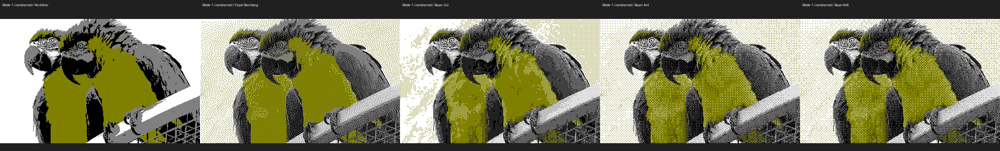
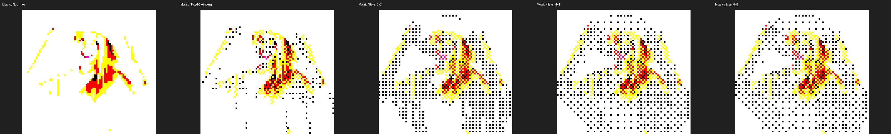
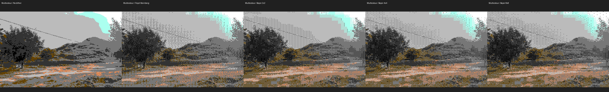

# Selected comparison sheets

Each sheet compares no dithering, Floyd–Steinberg and Bayer 2×2/4×4/8×8
with identical geometry, palette limits and neutral colour adjustments.
These are visual PNG previews of hardware-inspired constraints.

Only the labelled JPEG sheets are stored here. JPEG compression can add
colours; use the regenerated PNGs for exact palette/count inspection.
Source images and detailed rights records are in [samples/README.md](../README.md).

Regenerate from the project root into a new directory:

```bash
python examples/generate_samples.py --output-dir /path/to/new-sample-sheets
```

`manifest.json` records source and sheet checksums, conversion settings,
PNG checksums, colour counts and reproduction commands. Individual PNGs
are generated temporarily and omitted from this small published selection.

Commands below use `/path/to/image.jpg`; run them in a temporary output
directory with the indicated bundled source. They print POSIX shell syntax;
PowerShell users can enter the same options on one line.

## Blue-and-yellow macaws — cpc

Credit: Adrian Pingstone (Arpingstone), July 2004. Released into the public domain by the photographer, with an unrestricted-use fallback.



### Mode 1 / constrained / No dither

```bash
retroimg convert /path/to/image.jpg mode1-constrained-none.png --profile cpc-mode1 --cpc-mode constrained --dither none --scale 2 --fit cover
```

### Mode 1 / constrained / Floyd-Steinberg

```bash
retroimg convert /path/to/image.jpg mode1-constrained-fs.png --profile cpc-mode1 --cpc-mode constrained --dither floyd-steinberg --scale 2 --fit cover
```

### Mode 1 / constrained / Bayer 2x2

```bash
retroimg convert /path/to/image.jpg mode1-constrained-bayer2.png --profile cpc-mode1 --cpc-mode constrained --dither bayer --scale 2 --bayer-size 2 --fit cover
```

### Mode 1 / constrained / Bayer 4x4

```bash
retroimg convert /path/to/image.jpg mode1-constrained-bayer4.png --profile cpc-mode1 --cpc-mode constrained --dither bayer --scale 2 --bayer-size 4 --fit cover
```

### Mode 1 / constrained / Bayer 8x8

```bash
retroimg convert /path/to/image.jpg mode1-constrained-bayer8.png --profile cpc-mode1 --cpc-mode constrained --dither bayer --scale 2 --bayer-size 8 --fit cover
```

## Summer Girl Portrait — teletext

Credit: Petr Kratochvil. CC0 1.0 Universal Public Domain Dedication



### Mosaic / No dither

```bash
retroimg convert /path/to/image.jpg mosaic-none.png --profile teletext --teletext-mode mosaic --dither none --scale 6 --fit cover
```

### Mosaic / Floyd-Steinberg

```bash
retroimg convert /path/to/image.jpg mosaic-fs.png --profile teletext --teletext-mode mosaic --dither floyd-steinberg --scale 6 --fit cover
```

### Mosaic / Bayer 2x2

```bash
retroimg convert /path/to/image.jpg mosaic-bayer2.png --profile teletext --teletext-mode mosaic --dither bayer --scale 6 --bayer-size 2 --fit cover
```

### Mosaic / Bayer 4x4

```bash
retroimg convert /path/to/image.jpg mosaic-bayer4.png --profile teletext --teletext-mode mosaic --dither bayer --scale 6 --bayer-size 4 --fit cover
```

### Mosaic / Bayer 8x8

```bash
retroimg convert /path/to/image.jpg mosaic-bayer8.png --profile teletext --teletext-mode mosaic --dither bayer --scale 6 --bayer-size 8 --fit cover
```

## Green Landscape with Hills and Trees — c64

Credit: Baap8969. CC0 1.0 Universal Public Domain Dedication



### Multicolour / No dither

```bash
retroimg convert /path/to/image.jpg multicolour-none.png --profile c64-multicolour --c64-mode multicolour --dither none --scale 2 --fit cover
```

### Multicolour / Floyd-Steinberg

```bash
retroimg convert /path/to/image.jpg multicolour-fs.png --profile c64-multicolour --c64-mode multicolour --dither floyd-steinberg --scale 2 --fit cover
```

### Multicolour / Bayer 2x2

```bash
retroimg convert /path/to/image.jpg multicolour-bayer2.png --profile c64-multicolour --c64-mode multicolour --dither bayer --scale 2 --bayer-size 2 --fit cover
```

### Multicolour / Bayer 4x4

```bash
retroimg convert /path/to/image.jpg multicolour-bayer4.png --profile c64-multicolour --c64-mode multicolour --dither bayer --scale 2 --bayer-size 4 --fit cover
```

### Multicolour / Bayer 8x8

```bash
retroimg convert /path/to/image.jpg multicolour-bayer8.png --profile c64-multicolour --c64-mode multicolour --dither bayer --scale 2 --bayer-size 8 --fit cover
```
