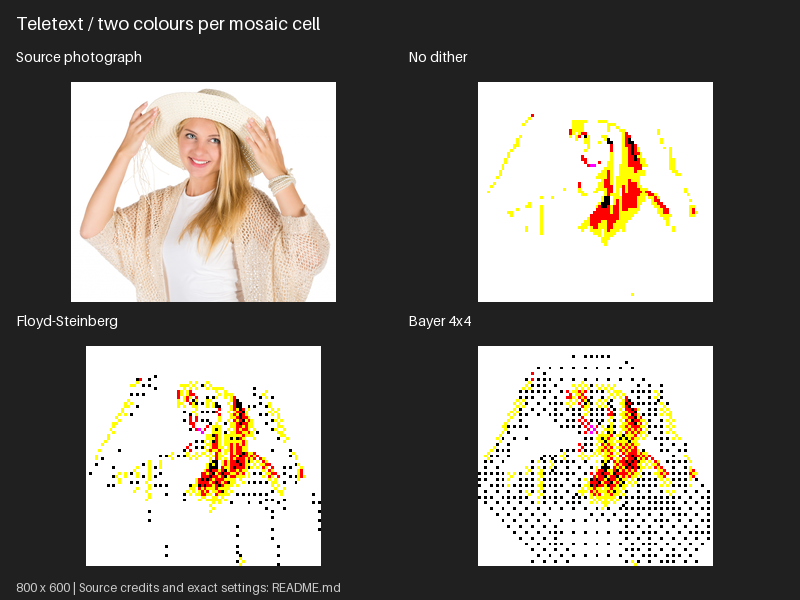

# Screen-sized sample comparisons

Eight lossless PNG panels, each **800 x 600**, arranged in two columns.
They cover all seven target families and one macaws colour-adjustment recipe.
Each target panel shows the source, no dither, Floyd–Steinberg and Bayer 4x4.
Representative modes keep this collection small; the target reference covers other modes.

Converted previews are fitted with nearest-neighbour resizing for documentation.
They are thumbnails; inspect regenerated individual PNGs for exact pixel patterns.
Source thumbnails use smooth resizing. Palette counts in the manifest refer to
the original conversions, not labels, source photos or whole panels.

Source credits and rights: [reference images](../README.md).

Refresh these panels from the project root:

```bash
python examples/generate_samples.py --replace
```

This defaults to `samples/comparisons`. Use `--output-dir /path/to/new-samples`
for a separate set. Only known sample files are replaced; other files are refused.
Individual conversions are temporary and cleaned up automatically.

The manifest records source/panel checksums, settings, PNG checksums and colour counts.
Commands use `/path/to/image.jpg`; substitute the indicated source and choose an output
directory. Commands are single-line POSIX syntax; the shown options also work in PowerShell.

## Amstrad CPC mode 0 / 16 screen colours

Source: [macaws.jpg](../sources/macaws.jpg). Credit: Adrian Pingstone (Arpingstone), July 2004. Released into the public domain by the photographer, with an unrestricted-use fallback.


<details>
<summary>Settings and reproduction commands</summary>

### No dither

```bash
retroimg convert /path/to/image.jpg macaws-cpc-none.png --profile cpc-mode0 --cpc-mode constrained --dither none --scale 2 --fit cover
```

### Floyd-Steinberg

```bash
retroimg convert /path/to/image.jpg macaws-cpc-floyd-steinberg.png --profile cpc-mode0 --cpc-mode constrained --dither floyd-steinberg --scale 2 --fit cover
```

### Bayer 4x4

```bash
retroimg convert /path/to/image.jpg macaws-cpc-bayer.png --profile cpc-mode0 --cpc-mode constrained --dither bayer --scale 2 --bayer-size 4 --fit cover
```

</details>

## Teletext / two colours per mosaic cell

Source: [portrait-colour.jpg](../sources/portrait-colour.jpg). Credit: Petr Kratochvil. CC0 1.0 Universal Public Domain Dedication



<details>
<summary>Settings and reproduction commands</summary>

### No dither

```bash
retroimg convert /path/to/image.jpg portrait-colour-teletext-none.png --profile teletext --teletext-mode mosaic --dither none --scale 6 --fit cover
```

### Floyd-Steinberg

```bash
retroimg convert /path/to/image.jpg portrait-colour-teletext-floyd-steinberg.png --profile teletext --teletext-mode mosaic --dither floyd-steinberg --scale 6 --fit cover
```

### Bayer 4x4

```bash
retroimg convert /path/to/image.jpg portrait-colour-teletext-bayer.png --profile teletext --teletext-mode mosaic --dither bayer --scale 6 --bayer-size 4 --fit cover
```

</details>

## Commodore 64 / multicolour cells

Source: [lush-landscape.jpg](../sources/lush-landscape.jpg). Credit: Baap8969. CC0 1.0 Universal Public Domain Dedication


<details>
<summary>Settings and reproduction commands</summary>

### No dither

```bash
retroimg convert /path/to/image.jpg lush-landscape-c64-none.png --profile c64-multicolour --c64-mode multicolour --dither none --scale 2 --fit cover
```

### Floyd-Steinberg

```bash
retroimg convert /path/to/image.jpg lush-landscape-c64-floyd-steinberg.png --profile c64-multicolour --c64-mode multicolour --dither floyd-steinberg --scale 2 --fit cover
```

### Bayer 4x4

```bash
retroimg convert /path/to/image.jpg lush-landscape-c64-bayer.png --profile c64-multicolour --c64-mode multicolour --dither bayer --scale 2 --bayer-size 4 --fit cover
```

</details>

## ZX Spectrum / attribute cells

Source: [lush-landscape.jpg](../sources/lush-landscape.jpg). Credit: Baap8969. CC0 1.0 Universal Public Domain Dedication


<details>
<summary>Settings and reproduction commands</summary>

### No dither

```bash
retroimg convert /path/to/image.jpg lush-landscape-spectrum-none.png --profile spectrum --spectrum-mode attributes --dither none --scale 2 --fit cover
```

### Floyd-Steinberg

```bash
retroimg convert /path/to/image.jpg lush-landscape-spectrum-floyd-steinberg.png --profile spectrum --spectrum-mode attributes --dither floyd-steinberg --scale 2 --fit cover
```

### Bayer 4x4

```bash
retroimg convert /path/to/image.jpg lush-landscape-spectrum-bayer.png --profile spectrum --spectrum-mode attributes --dither bayer --scale 2 --bayer-size 4 --fit cover
```

</details>

## BBC Micro mode 2 / eight steady colours

Source: [macaws.jpg](../sources/macaws.jpg). Credit: Adrian Pingstone (Arpingstone), July 2004. Released into the public domain by the photographer, with an unrestricted-use fallback.


<details>
<summary>Settings and reproduction commands</summary>

### No dither

```bash
retroimg convert /path/to/image.jpg macaws-bbc-none.png --profile bbc-mode2 --bbc-mode constrained --dither none --scale 2 --fit cover
```

### Floyd-Steinberg

```bash
retroimg convert /path/to/image.jpg macaws-bbc-floyd-steinberg.png --profile bbc-mode2 --bbc-mode constrained --dither floyd-steinberg --scale 2 --fit cover
```

### Bayer 4x4

```bash
retroimg convert /path/to/image.jpg macaws-bbc-bayer.png --profile bbc-mode2 --bbc-mode constrained --dither bayer --scale 2 --bayer-size 4 --fit cover
```

</details>

## Amiga PAL low resolution / 32 colours

Source: [portrait-colour.jpg](../sources/portrait-colour.jpg). Credit: Petr Kratochvil. CC0 1.0 Universal Public Domain Dedication


<details>
<summary>Settings and reproduction commands</summary>

### No dither

```bash
retroimg convert /path/to/image.jpg portrait-colour-amiga-none.png --profile amiga-lores --amiga-mode constrained --colours 32 --dither none --scale 2 --fit cover
```

### Floyd-Steinberg

```bash
retroimg convert /path/to/image.jpg portrait-colour-amiga-floyd-steinberg.png --profile amiga-lores --amiga-mode constrained --colours 32 --dither floyd-steinberg --scale 2 --fit cover
```

### Bayer 4x4

```bash
retroimg convert /path/to/image.jpg portrait-colour-amiga-bayer.png --profile amiga-lores --amiga-mode constrained --colours 32 --dither bayer --scale 2 --bayer-size 4 --fit cover
```

</details>

## Atari 2600 NTSC / independent playfield

Source: [lush-landscape.jpg](../sources/lush-landscape.jpg). Credit: Baap8969. CC0 1.0 Universal Public Domain Dedication


<details>
<summary>Settings and reproduction commands</summary>

### No dither

```bash
retroimg convert /path/to/image.jpg lush-landscape-atari2600-none.png --profile atari2600-ntsc --atari-mode playfield --dither none --scale 2 --fit cover
```

### Floyd-Steinberg

```bash
retroimg convert /path/to/image.jpg lush-landscape-atari2600-floyd-steinberg.png --profile atari2600-ntsc --atari-mode playfield --dither floyd-steinberg --scale 2 --fit cover
```

### Bayer 4x4

```bash
retroimg convert /path/to/image.jpg lush-landscape-atari2600-bayer.png --profile atari2600-ntsc --atari-mode playfield --dither bayer --scale 2 --bayer-size 4 --fit cover
```

</details>

## CPC mode 1 / Bayer 2x2 / source adjustments

Source: [macaws.jpg](../sources/macaws.jpg). Credit: Adrian Pingstone (Arpingstone), July 2004. Released into the public domain by the photographer, with an unrestricted-use fallback.


<details>
<summary>Settings and reproduction commands</summary>

### Baseline: saturation 1.1

```bash
retroimg convert /path/to/image.jpg macaws-adjustments-baseline.png --profile cpc-mode1 --cpc-mode constrained --dither bayer --bayer-size 2 --saturation 1.1 --scale 2 --fit cover
```

### Blue gain 1.5

```bash
retroimg convert /path/to/image.jpg macaws-adjustments-blue.png --profile cpc-mode1 --cpc-mode constrained --dither bayer --bayer-size 2 --saturation 1.1 --scale 2 --blue-gain 1.5 --fit cover
```

### Blue 1.5 + brightness 1.5

```bash
retroimg convert /path/to/image.jpg macaws-adjustments-brightness.png --profile cpc-mode1 --cpc-mode constrained --dither bayer --bayer-size 2 --saturation 1.1 --scale 2 --blue-gain 1.5 --brightness 1.5 --fit cover
```

### Blue 1.5 + brightness 1.5 + contrast 1.2

```bash
retroimg convert /path/to/image.jpg macaws-adjustments-contrast.png --profile cpc-mode1 --cpc-mode constrained --dither bayer --bayer-size 2 --saturation 1.1 --scale 2 --blue-gain 1.5 --brightness 1.5 --contrast 1.2 --fit cover
```

</details>
