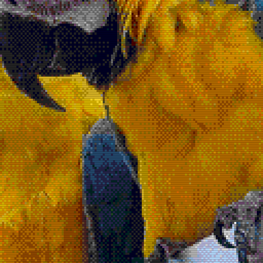
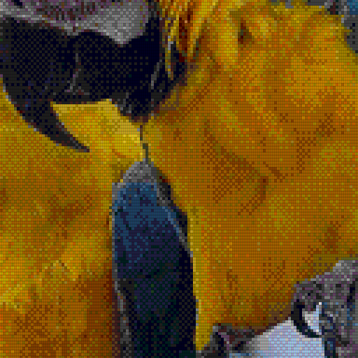
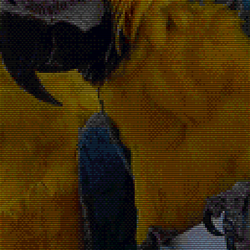
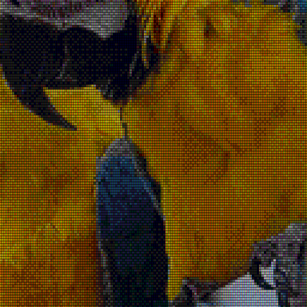

# CRT aperture-grille examples

The same 320×224 Mega Drive tile conversion, rendered at scale 4 with
4:3 aspect correction (1280×960). One scanline beam per logical row:
224 beams across the full image height, with smooth fractional spacing.
The grille repeats one red, green and blue stripe across three output columns.
Strength controls both the grille and scanlines. A scanlines-only version
at the same subtle strength isolates what the grille adds.
The final example adds display brightness 2.0 after the strong effect,
preserving the same palette conversion and dithering.
Each detail crop is an unscaled 512×512 section of its full-size PNG.
Open the PNGs at 100% to judge the display pattern; browser fitting can introduce moiré.

Source: [macaws.jpg](../sources/macaws.jpg).
Credit: Adrian Pingstone (Arpingstone), July 2004. Released into the public domain by the photographer, with an unrestricted-use fallback.
See [source records](../README.md) and [effect documentation](../../docs/display-effects.md).

The CRT treatment combines scanlines and an RGB grille in linear light; there is no bloom.
This is a static aesthetic approximation. Conversion codes are identical.

## Plain conversion

[Open full-size example](megadrive-plain.png) · [Open detail crop](megadrive-plain-crop.png)


```bash
retroimg convert /path/to/image.jpg megadrive-plain.png --profile megadrive-320 --megadrive-mode tiles --scale 4 --fit cover --dither bayer --bayer-size 4
```

## Scanlines only / strength 0.35

[Open full-size example](megadrive-scanlines-only.png) · [Open detail crop](megadrive-scanlines-only-crop.png)



```bash
retroimg convert /path/to/image.jpg megadrive-scanlines-only.png --profile megadrive-320 --megadrive-mode tiles --scale 4 --fit cover --dither bayer --bayer-size 4 --display-effect scanlines --effect-strength 0.35
```

## CRT aperture / strength 0.35

[Open full-size example](megadrive-crt-aperture-subtle.png) · [Open detail crop](megadrive-crt-aperture-subtle-crop.png)



```bash
retroimg convert /path/to/image.jpg megadrive-crt-aperture-subtle.png --profile megadrive-320 --megadrive-mode tiles --scale 4 --fit cover --dither bayer --bayer-size 4 --display-effect crt-aperture --effect-strength 0.35
```

## CRT aperture / strength 0.85

[Open full-size example](megadrive-crt-aperture-strong.png) · [Open detail crop](megadrive-crt-aperture-strong-crop.png)



```bash
retroimg convert /path/to/image.jpg megadrive-crt-aperture-strong.png --profile megadrive-320 --megadrive-mode tiles --scale 4 --fit cover --dither bayer --bayer-size 4 --display-effect crt-aperture --effect-strength 0.85
```

## CRT aperture / strength 0.85 / display brightness 2.0 after effects

[Open full-size example](megadrive-crt-aperture-strong-brighter.png) · [Open detail crop](megadrive-crt-aperture-strong-brighter-crop.png)



```bash
retroimg convert /path/to/image.jpg megadrive-crt-aperture-strong-brighter.png --profile megadrive-320 --megadrive-mode tiles --scale 4 --fit cover --dither bayer --bayer-size 4 --display-effect crt-aperture --effect-strength 0.85 --display-brightness 2.0
```

Refresh from the project root:

```bash
python examples/generate_display_effects.py --effect crt-aperture --replace
```
