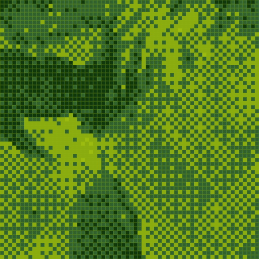
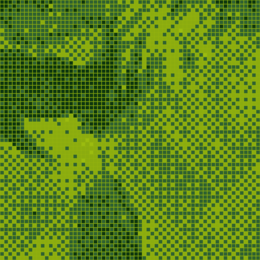

# Game Boy LCD display examples

The same 160×144 four-shade conversion, rendered at 8× (1280×1152).
Each native Game Boy pixel occupies an 8×8 output area so the LCD cell borders
and shadows can be drawn. The conversion still contains only 160×144 logical pixels.
Each detail crop is an unscaled 512×512 section of its full-size PNG.
Open the PNGs at 100% to judge the cell grid; browser fitting can introduce moiré.

Source: [macaws.jpg](../sources/macaws.jpg).
Credit: Adrian Pingstone (Arpingstone), July 2004. Released into the public domain by the photographer, with an unrestricted-use fallback.
See [source records](../README.md) and [effect documentation](../../docs/display-effects.md).

The LCD treatment simulates inset cells and small shadows. It does not model
motion response or claim measured LCD colour accuracy. Conversion codes are identical.

## Plain conversion

[Open full-size example](gameboy-plain.png) · [Open detail crop](gameboy-plain-crop.png)


```bash
retroimg convert /path/to/image.jpg gameboy-plain.png --profile gameboy --gameboy-mode tiles --fit cover --dither bayer --bayer-size 4 --scale 8
```

## LCD / strength 0.35

[Open full-size example](gameboy-lcd-subtle.png) · [Open detail crop](gameboy-lcd-subtle-crop.png)



```bash
retroimg convert /path/to/image.jpg gameboy-lcd-subtle.png --profile gameboy --gameboy-mode tiles --fit cover --dither bayer --bayer-size 4 --scale 8 --display-effect gameboy-lcd --effect-strength 0.35
```

## LCD / strength 0.85

[Open full-size example](gameboy-lcd-strong.png) · [Open detail crop](gameboy-lcd-strong-crop.png)



```bash
retroimg convert /path/to/image.jpg gameboy-lcd-strong.png --profile gameboy --gameboy-mode tiles --fit cover --dither bayer --bayer-size 4 --scale 8 --display-effect gameboy-lcd --effect-strength 0.85
```

Refresh from the project root:

```bash
python examples/generate_display_effects.py --replace
```
