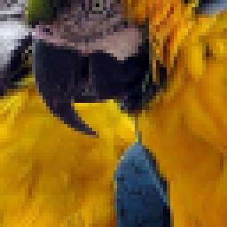

# Original-colour pixelation

The source image retains its 750×536 dimensions and uses RGB colour averages,
with no hardware palette, dithering or colour-count limit. Block size is in
source pixels. Each detail crop is an unscaled 256×256 section of the full PNG.
Open the PNGs at 100% to compare the block sizes.

Source: [macaws.jpg](../sources/macaws.jpg).
Credit: Adrian Pingstone (Arpingstone), July 2004. Released into the public domain by the photographer, with an unrestricted-use fallback.
See [pixelation documentation](../../docs/pixelation.md).

## 4×4 blocks

[Open full-size image](macaws-block4.png) · [Open detail crop](macaws-block4-crop.png)



```bash
retroimg pixelate /path/to/image.jpg macaws-block4.png --block-size 4
```

## 8×8 blocks

[Open full-size image](macaws-block8.png) · [Open detail crop](macaws-block8-crop.png)


```bash
retroimg pixelate /path/to/image.jpg macaws-block8.png --block-size 8
```

## 16×16 blocks

[Open full-size image](macaws-block16.png) · [Open detail crop](macaws-block16-crop.png)


```bash
retroimg pixelate /path/to/image.jpg macaws-block16.png --block-size 16
```

Refresh from the project root:

```bash
python examples/generate_pixelation.py --replace
```
