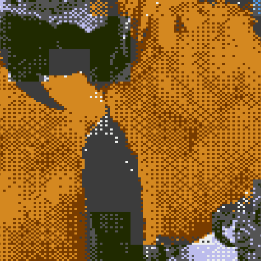
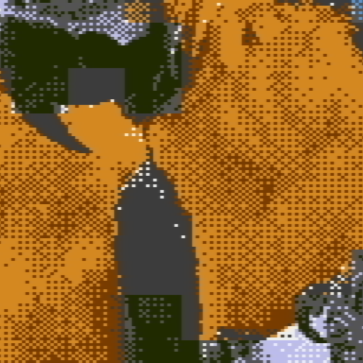
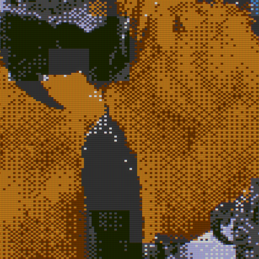
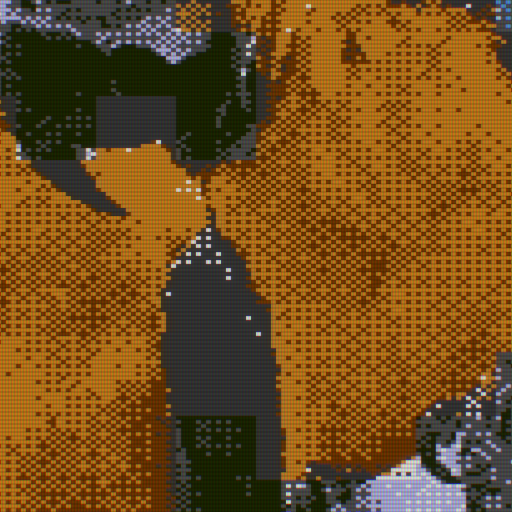

# RF-style colour bleed and combined CRT effects

The same 256×240 NES attribute-constrained macaws conversion, rendered
at scale 4 with aspect correction (1280×960).
Compare plain, subtle/strong RF alone, then the optical CRT stack
without and with the same RF strengths. Colour boundaries smear
horizontally with a slight rightward trail; brightness detail stays sharper.
Combined versions keep chromatic strength 0.25, CRT strength 0.35,
bloom strength 0.25/radius 1, and display brightness 1 fixed.
RF is a static aesthetic signal treatment, not a full RF or NES NTSC decoder.
Order: RF, chromatic aberration, CRT grille/scanlines, bloom, final brightness.
Each detail crop is an unscaled 512×512 section of its full-size PNG.
Open the PNGs at 100% to judge the display pattern; browser fitting can introduce moiré.

Source: [macaws.jpg](../sources/macaws.jpg).
Credit: Adrian Pingstone (Arpingstone), July 2004. Released into the public domain by the photographer, with an unrestricted-use fallback.
See [source records](../README.md) and [effect documentation](../../docs/display-effects.md).

The original indexed conversion stays unchanged by all effects.
This is a static aesthetic approximation. Conversion codes are identical.

## Plain conversion

[Open full-size example](nes-plain.png) · [Open detail crop](nes-plain-crop.png)



```bash
retroimg convert /path/to/image.jpg nes-plain.png --profile nes --nes-mode attributes --scale 4 --fit cover --dither bayer --bayer-size 4
```

## RF alone / RF strength 0.35

[Open full-size example](nes-rf-subtle.png) · [Open detail crop](nes-rf-subtle-crop.png)


```bash
retroimg convert /path/to/image.jpg nes-rf-subtle.png --profile nes --nes-mode attributes --scale 4 --fit cover --dither bayer --bayer-size 4 --rf-strength 0.35
```

## RF alone / RF strength 0.85

[Open full-size example](nes-rf-strong.png) · [Open detail crop](nes-rf-strong-crop.png)



```bash
retroimg convert /path/to/image.jpg nes-rf-strong.png --profile nes --nes-mode attributes --scale 4 --fit cover --dither bayer --bayer-size 4 --rf-strength 0.85
```

## CRT + chromatic aberration + bloom, without RF

[Open full-size example](nes-crt-optics.png) · [Open detail crop](nes-crt-optics-crop.png)



```bash
retroimg convert /path/to/image.jpg nes-crt-optics.png --profile nes --nes-mode attributes --scale 4 --fit cover --dither bayer --bayer-size 4 --display-effect crt-aperture --effect-strength 0.35 --chromatic-strength 0.25 --bloom-strength 0.25 --bloom-radius 1.0
```

## CRT + chromatic aberration + bloom + RF / RF strength 0.35

[Open full-size example](nes-crt-optics-rf-subtle.png) · [Open detail crop](nes-crt-optics-rf-subtle-crop.png)



```bash
retroimg convert /path/to/image.jpg nes-crt-optics-rf-subtle.png --profile nes --nes-mode attributes --scale 4 --fit cover --dither bayer --bayer-size 4 --display-effect crt-aperture --effect-strength 0.35 --chromatic-strength 0.25 --bloom-strength 0.25 --bloom-radius 1.0 --rf-strength 0.35
```

## CRT + chromatic aberration + bloom + RF / RF strength 0.85

[Open full-size example](nes-crt-optics-rf-strong.png) · [Open detail crop](nes-crt-optics-rf-strong-crop.png)


```bash
retroimg convert /path/to/image.jpg nes-crt-optics-rf-strong.png --profile nes --nes-mode attributes --scale 4 --fit cover --dither bayer --bayer-size 4 --display-effect crt-aperture --effect-strength 0.35 --chromatic-strength 0.25 --bloom-strength 0.25 --bloom-radius 1.0 --rf-strength 0.85
```

Refresh from the project root:

```bash
python examples/generate_display_effects.py --effect rf --replace
```
