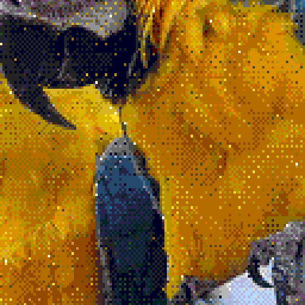
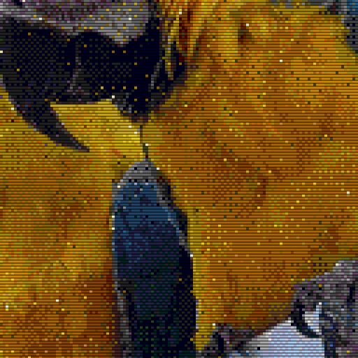

# Scanline display examples

The same 320×224 Mega Drive tile conversion, rendered at scale 4 with
4:3 aspect correction (1280×960). One scanline beam per logical row:
224 beams across the full image height, with smooth fractional spacing.
Each detail crop is an unscaled 512×512 section of its full-size PNG.
Open the PNGs at 100% to judge the display pattern; browser fitting can introduce moiré.

Source: [macaws.jpg](../sources/macaws.jpg).
Credit: Adrian Pingstone (Arpingstone), July 2004. Released into the public domain by the photographer, with an unrestricted-use fallback.
See [source records](../README.md) and [effect documentation](../../docs/display-effects.md).

Scanlines dim row boundaries in linear light; there is no phosphor mask or bloom.
This is a static aesthetic approximation. Conversion codes are identical.

## Plain conversion

[Open full-size example](megadrive-plain.png) · [Open detail crop](megadrive-plain-crop.png)



```bash
retroimg convert /path/to/image.jpg megadrive-plain.png --profile megadrive-320 --megadrive-mode tiles --scale 4 --fit cover --dither bayer --bayer-size 4
```

## Scanlines / strength 0.35

[Open full-size example](megadrive-scanlines-subtle.png) · [Open detail crop](megadrive-scanlines-subtle-crop.png)


```bash
retroimg convert /path/to/image.jpg megadrive-scanlines-subtle.png --profile megadrive-320 --megadrive-mode tiles --scale 4 --fit cover --dither bayer --bayer-size 4 --display-effect scanlines --effect-strength 0.35
```

## Scanlines / strength 0.85

[Open full-size example](megadrive-scanlines-strong.png) · [Open detail crop](megadrive-scanlines-strong-crop.png)



```bash
retroimg convert /path/to/image.jpg megadrive-scanlines-strong.png --profile megadrive-320 --megadrive-mode tiles --scale 4 --fit cover --dither bayer --bayer-size 4 --display-effect scanlines --effect-strength 0.85
```

Refresh from the project root:

```bash
python examples/generate_display_effects.py --effect scanlines --replace
```
